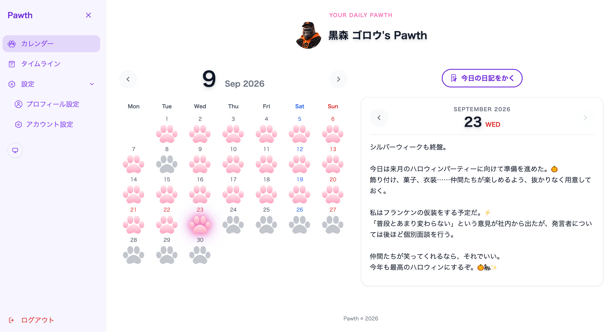
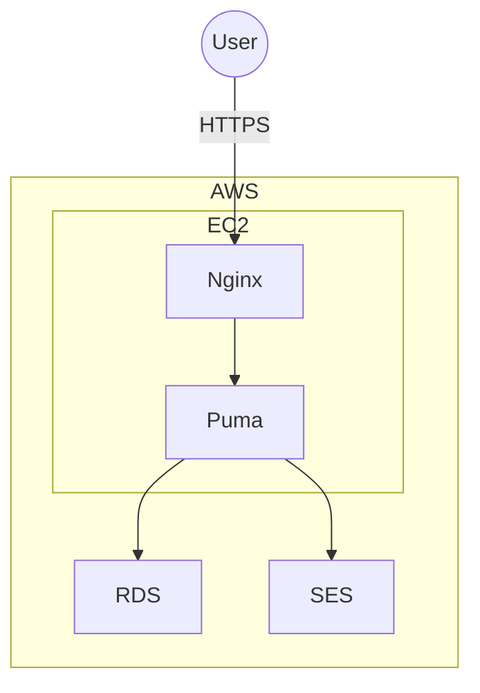

# Pawth 🐾

## 〜日々の足あとを描く〜

Pawth（パウス）は、日々の足あとを描く、小さなWeb日記アプリです。

その日の記録を残し、カレンダーやタイムラインからこれまでの歩みを振り返ることができます。

## 設計思想

Pawthでは、その日の記録を、その日のうちに残すことを大切にしています。

- 日記の投稿は1日1件、当日のみ
- 編集は当日中に3回まで
- 過去の日記は編集不可
- 当日の削除は不可、翌日以降は削除可能

そのときの自分が残した言葉を、未来へ届けるためのルールです。

## 紹介サイト

🌐 [Webサイトを見る](https://pawth-lp.hamltail.dev/)

Alternative: [Vercel](https://pawth-lp.vercel.app/)



## 技術スタック

| Category       | Technology                                            |
| -------------- | ----------------------------------------------------- |
| Frontend       | Haml, Tailwind CSS, JavaScript, Turbo, Stimulus, GSAP |
| Backend        | Ruby 4.0.7, Rails 8.1.4                               |
| Database       | PostgreSQL 18                                         |
| Authentication | Devise                                                |
| Testing        | RSpec, FactoryBot, SimpleCov, Playwright, axe-core    |
| Infrastructure | AWS (EC2, RDS, SES)                                   |

## セットアップ

### ローカル環境

```bash
git clone https://github.com/hamltail/pawth.git
cd pawth
bundle install
npm ci
rails db:setup
bin/dev
```

### Docker

開発環境をビルドして起動します。

```bash
docker compose -f compose.dev.yml up --build -d
```

データベースをセットアップします。

```bash
docker compose -f compose.dev.yml exec web bin/rails db:migrate
docker compose -f compose.dev.yml exec web bin/rails db:seed
```

停止する場合

```bash
docker compose -f compose.dev.yml down
```

### 開発環境でのメール確認

PawthはDevise Confirmableを利用しています。

Docker開発環境では、確認メールを`letter_opener_web`から確認できます。

```text
http://localhost:3000/letter_opener
```

## 本番構成（公開終了）

PawthはAWS上で以下の構成で公開していました。  
現在は公開を終了しています。



## License

このリポジトリは、ポートフォリオ目的で公開しています。

著作権は作者に帰属します。  
無断転載・再配布・商用利用はご遠慮ください。

This repository is published for portfolio purposes only.

All rights to the content belong to the author.

Please do not reproduce, redistribute, or use any part of this project for commercial purposes without permission.

## Author

- hamltail
